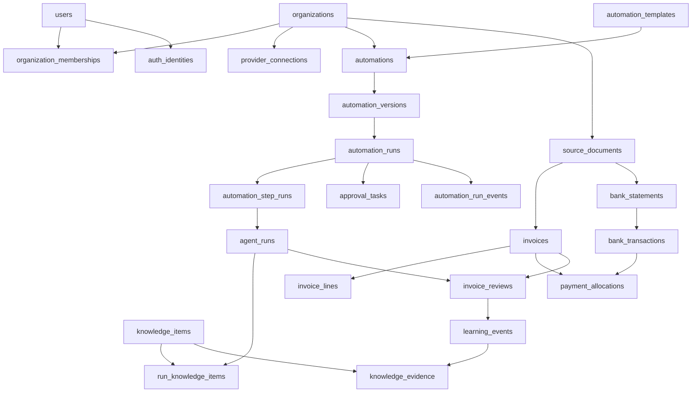

# Shared Platform Database Design

## Purpose

This document defines a greenfield PostgreSQL model for BeezOps Platform, hosted on Neon. Shared platform tables support tenant identity, provider connections, agent execution, evidence-backed learning, and durable automations. Product domains own their authoritative business records.

The first product workflow is **Invoice & Bank Statement Reconciliation**. RedZone and Accounting may share the learning primitives, but their knowledge is isolated by product and scope.

## Design principles

- Every tenant-owned row is scoped by `organization_id`.
- Authentication identity, organization membership, and provider connections are separate concerns.
- Agent runs, workflow runs, learning events, and reusable knowledge are distinct records.
- Learning events are append-only evidence. Knowledge items are inferred, versioned, and reviewable; they are not authoritative business facts.
- Agent recommendations do not change accounting facts or approve payments by themselves.
- Store provider connection references, not OAuth credentials. Nango owns provider tokens.
- Store document metadata and references in Postgres; keep document bytes in Drive or object storage.
- Persist structured results and evidence references; avoid retaining raw prompts or sensitive document contents by default.
- Workflow configuration is versioned data validated against a versioned application schema. Do not store executable code in the database.

## Schema change workflow

The Drizzle table definitions and their generated migration belong in the same pull request. This keeps the TypeScript model and the database change reviewable together.

- Edit the schema under `packages/database/src/schema/`.
- Generate a migration with `npm run db:generate --workspace @beezops/database -- --name=<change-name>`.
- Review the generated SQL under `packages/database/drizzle/` and commit it with the schema changes.
- Apply pending migrations to the intended database with `npm run db:migrate --workspace @beezops/database` after providing that environment's `DATABASE_URL`.

For local development, place `DATABASE_URL` in the repository-root `.env.local`; the Drizzle config loads that file (and `.env` as a fallback). These files are ignored by Git. Vercel-provided environment variables take precedence when the migration command runs in a deployment environment.

Drizzle records applied migration versions in its migration ledger, so the migration command can run on every deployment while applying only versions the database has not seen. Generating a migration does not connect to or modify a database. Applying migrations is a distinct deployment step; `npm run dev` and the application build do not apply them automatically. Never point a local migration command at staging or production by accident.

For this first schema PR, validate the migration by reviewing the generated SQL, running `npm run check-types --workspace @beezops/database`, and running `npm run db:migrate --workspace @beezops/database` only with the dev database URL when you are ready to create the dev tables.

## Shared platform tables

### Identity and tenant tables

#### `organizations`

A tenant/customer workspace.

- `id` UUID primary key
- `name`, `slug`
- `status`
- `created_at`, `updated_at`

Unique: `slug`.

#### `users`

A BeezOps user profile, independent of which organization they are using.

- `id` UUID primary key
- `email`, `display_name`
- `status`
- `created_at`, `updated_at`

Unique: normalized `email`.

#### `auth_identities`

Maps an external sign-in identity to a BeezOps user. This is not a provider data connection.

- `id` UUID primary key
- `user_id` foreign key to `users`
- `provider` and `provider_subject`
- `email_at_provider` (optional)
- `created_at`, `last_seen_at`

Unique: `(provider, provider_subject)`.

#### `organization_memberships`

Connects users to tenant organizations and carries tenant roles.

- `organization_id` foreign key to `organizations`
- `user_id` foreign key to `users`
- `role`, `status`
- `created_at`, `updated_at`

Primary key: `(organization_id, user_id)`.

#### `provider_connections`

An organization's authorized connection to an external provider such as Google Drive or QuickBooks.

- `id` UUID primary key
- `organization_id` foreign key to `organizations`
- `provider`, `integration_key`, `external_connection_id`
- `display_name`, `account_metadata` JSONB
- `status`, `connected_by_user_id`
- `created_at`, `updated_at`, `last_synced_at`

Unique: `(organization_id, provider, external_connection_id)`. Never store access or refresh tokens in this table.

### Agent execution and learning tables

#### `agent_runs`

One invocation of an agent, whether started directly or by an automation step.

- `id` UUID primary key
- `organization_id`, `product_key`, `agent_key`
- `status`
- `model_key`, `prompt_version`, `agent_version`
- `source_type`, `source_id` for the primary subject
- `result` JSONB (structured recommendation and evidence references)
- `error_code`, `error_summary` (sanitized)
- `started_at`, `completed_at`, `created_at`
- `source_type` and `source_id` are nullable for runs without a single primary record.

Indexes: `(organization_id, product_key, created_at)` and `(organization_id, status)`.

#### `learning_events`

Append-only observations, outcomes, and human corrections. A correction is evidence for learning, not automatically a standing rule.

- `id` UUID primary key
- `organization_id`, `product_key`
- `agent_run_id` (nullable FK to `agent_runs`)
- `event_type` (for example, `review_correction`, `decision_confirmed`, `outcome_observed`)
- `source_type`, `source_id` (PR/review for RedZone; invoice/review for Accounting)
- `idempotency_key` (nullable; organization/product scoped when supplied)
- `subject_type`, `subject_id` (repository/module or vendor/invoice line)
- `actor_user_id` (nullable for system observations)
- `proposed_value`, `final_value`, `details` JSONB; values must be minimized and sanitized
- `occurred_at`, `recorded_at`

Use an organization-scoped idempotency key or unique source identity where the source system provides a stable event ID.

#### `knowledge_items`

A reusable, inspectable pattern inferred from one or more learning events.

- `id` UUID primary key
- `organization_id`, `product_key`
- `knowledge_type` (for example, `semantic`, `procedural`, `learned_preference`)
- `scope_type`, `scope_id` (for example, repository, code area, vendor, or invoice category)
- `title`, `summary`, `content` JSONB
- `status` (`candidate`, `active`, `disputed`, `superseded`, `archived`)
- `confidence` numeric in `[0,1]`
- `effective_from`, `effective_until`, `last_evidence_at`
- `version`, `supersedes_id` (nullable self-reference)
- `created_at`, `updated_at`

Indexes: `(organization_id, product_key, status)` and `(organization_id, product_key, scope_type, scope_id)`.

#### `knowledge_evidence`

Many-to-many provenance between a knowledge item and the learning events that support, contradict, or update it.

- `knowledge_item_id` FK to `knowledge_items`
- `learning_event_id` FK to `learning_events`
- `organization_id`, `product_key` are carried through the relation and checked against both parent rows, preventing cross-tenant or cross-product evidence links.
- `relation` (`supports`, `contradicts`, `updates`)
- `created_at`

Primary key: `(organization_id, knowledge_item_id, learning_event_id, relation)`.

#### `run_knowledge_items`

Records which knowledge items an agent run retrieved and why, so the UI can explain the recommendation.

- `agent_run_id` FK to `agent_runs`
- `knowledge_item_id` FK to `knowledge_items`
- `organization_id`, `product_key` are checked against both parent rows, preventing cross-tenant or cross-product retrieval links.
- `retrieval_reason`, `rank`, `created_at`

Primary key: `(organization_id, agent_run_id, knowledge_item_id)`.

### Automation tables

#### `automation_templates`

The out-of-the-box automation catalog, such as **Invoice & Bank Statement Reconciliation**.

- `id` UUID primary key
- `product_key`, `template_key`, `name`, `description`
- `template_version`
- `definition` JSONB (trigger and ordered step configuration)
- `definition_schema_version`
- `status`, `created_at`, `updated_at`

Unique: `(product_key, template_key, template_version)`. Published template versions are immutable.

#### `automations`

An organization-configured instance of a template.

- `id` UUID primary key
- `organization_id` foreign key to `organizations`
- `template_id` foreign key to `automation_templates`
- `name`, `status`, `settings` JSONB
- `created_by_user_id`
- `created_at`, `updated_at`

#### `automation_versions`

Immutable snapshots of the organization's configured definition. A running workflow always points to the version it started with.

- `id` UUID primary key
- `automation_id` foreign key to `automations`
- `version_number`
- `definition` JSONB (validated trigger, steps, transitions, and settings)
- `definition_schema_version`
- `published_by_user_id`, `published_at`, `created_at`

Unique: `(automation_id, version_number)`.

#### `automation_runs`

One durable execution of a configured automation.

- `id` UUID primary key
- `organization_id`, `automation_id`, `automation_version_id`
- `trigger_type`, `trigger_source_type`, `trigger_source_id`
- `idempotency_key`
- `workflow_engine`, `workflow_run_id` (reference to the durable workflow runtime)
- `status`, `started_at`, `completed_at`, `created_at`
- `result_summary` JSONB (safe product-facing summary)

Unique: `(organization_id, automation_id, idempotency_key)`.

#### `automation_step_runs`

Execution status for each step in the run. An `agent` step links to `agent_runs`; an `approval` step links to an approval task.

- `id` UUID primary key
- `organization_id`, `automation_run_id`
- `step_key`, `step_type`, `status`, `attempt`
- `agent_run_id` nullable FK to `agent_runs`
- `input_reference`, `output_summary`, `error_summary` JSONB/text, minimized and sanitized
- `started_at`, `completed_at`, `created_at`

Unique: `(automation_run_id, step_key, attempt)`.

#### `approval_tasks`

A human decision that may suspend and later resume an automation.

- `id` UUID primary key
- `organization_id`, `automation_run_id`, `automation_step_run_id`
- `assignee_user_id` (nullable if assigned to a role/queue)
- `status` (`pending`, `approved`, `rejected`, `cancelled`, `expired`)
- `requested_decision`, `decision`, `decision_note`
- `decided_by_user_id`, `requested_at`, `decided_at`, `due_at`

#### `automation_run_events`

Append-only timeline for status transitions and significant workflow events.

- `id` UUID primary key
- `organization_id`, `automation_run_id`
- `event_type`, `step_key` (nullable), `details` JSONB
- `occurred_at`

### Automation definition for the first workflow

The template key is `invoice_bank_statement_reconciliation`. Its definition can contain:

1. Trigger on `document.imported`, filtered to invoice or bank statement documents.
2. Extract and normalize document data.
3. Match invoices and bank transactions deterministically where possible.
4. Call an agent for ambiguous matches or correction recommendations.
5. Create an approval task when review is needed.
6. Record a confirmed allocation only after approval.

Triggering on either document is supported. Use the imported document identity as the source for idempotency. If a counterpart is not available, report `unmatched` or `pending_reconciliation`; do not infer `unpaid` solely from absence of a match.

## Accounting-owned tables

All records below carry `organization_id` and are owned by `domains/accounting`.

#### `source_documents`

- `id` UUID primary key
- `organization_id`, `provider_connection_id` nullable FK to `provider_connections`
- `document_type` (`invoice`, `bank_statement`)
- `external_file_id`, `file_name`, `mime_type`, `checksum`, `storage_reference`
- `import_status`, `imported_by_user_id`, `imported_at`, timestamps

Unique on `(organization_id, provider_connection_id, external_file_id)` where an external ID exists. Store file bytes in Drive or object storage, not Postgres.

#### `vendors`

- `id` UUID primary key
- `organization_id`, `display_name`, normalized identity fields
- provider/source references as needed
- `created_at`, `updated_at`

#### `invoices`

- `id` UUID primary key
- `organization_id`, `source_document_id` FK to `source_documents`
- `vendor_id` FK to `vendors`
- `invoice_number`, `invoice_date`, `due_date`, `currency`, `subtotal`, `tax_amount`, `total_amount`
- `review_status`, `extraction_status`
- `created_at`, `updated_at`

Unique where appropriate: `(organization_id, vendor_id, invoice_number)`.

#### `invoice_lines`

- `id` UUID primary key
- `organization_id`, `invoice_id` FK to `invoices`
- `line_number`, `description`, `quantity`, `unit_amount`, `line_amount`, `currency`
- `suggested_gl_code`, `confirmed_gl_code` (nullable until reviewed)
- `created_at`, `updated_at`

#### `bank_statements`

- `id` UUID primary key
- `organization_id`, `source_document_id` FK to `source_documents`
- `account_label`, `period_start`, `period_end`, `currency`
- `import_status`, `created_at`

#### `bank_transactions`

- `id` UUID primary key
- `organization_id`, `bank_statement_id` FK to `bank_statements`
- `external_transaction_id`, `posted_at`, `description`, signed `amount`, `currency`, `reference`
- `created_at`

#### `payment_allocations`

- `id` UUID primary key
- `organization_id`, `invoice_id` FK to `invoices`, `bank_transaction_id` FK to `bank_transactions`
- `amount`, `currency`, `status` (`proposed`, `confirmed`, `rejected`)
- `proposed_by_agent_run_id` nullable FK to `agent_runs`
- `confirmed_by_user_id`, `confirmed_at`, `created_at`

A transaction can pay multiple invoices and an invoice can be paid by multiple transactions. Only confirmed allocations contribute to derived payment status.

#### `invoice_reviews`

- `id` UUID primary key
- `organization_id`, `invoice_id` FK to `invoices`
- `agent_run_id` nullable FK to `agent_runs`
- `reviewer_user_id`, `decision`, `corrections` JSONB, `comment`, `created_at`
- `learning_event_id` nullable FK to `learning_events`

## Relationship overview

## Tenant safety and integrity

- Include `organization_id` on every tenant-owned table and in tenant-scoped indexes.
- Use composite foreign keys or equivalent constraints so a child row cannot reference a parent from a different organization.
- Enforce tenant scope in every repository/service query; consider PostgreSQL row-level security when the access layer is ready.
- Use idempotency keys for document-import triggers and provider webhooks.
- Treat source events and review decisions as append-only. Retire or supersede knowledge instead of erasing its evidence.
- Do not set an invoice to paid based on an agent recommendation. Derive that status from confirmed allocations.

## Ownership in the monorepo

- `packages/database`: shared PostgreSQL/Drizzle client, shared platform schema, and typed database utilities.
- `packages/auth`: sign-in and identity integration; tenant membership remains in the shared database.
- `packages/connections`: provider connection lifecycle and Nango references.
- `packages/ai-platform`: agent execution, learning/knowledge retrieval interfaces, and automation runtime interfaces.
- `domains/accounting`: accounting schema and reconciliation domain logic.
- `domains/code-risk`: RedZone domain schema/logic, using shared agent/learning primitives where appropriate.
- Apps compose these packages and domains; they should not duplicate platform table definitions.

## Initial scope

Implement the shared identity, connection, agent/learning, and automation tables needed for one tenant-scoped reconciliation demo. Add Accounting tables for imported invoices and statements, matching, review, and confirmed allocations. Defer hierarchical organizations, accounting-firm client grants, general-purpose workflow builders, vector databases, and payment initiation.
